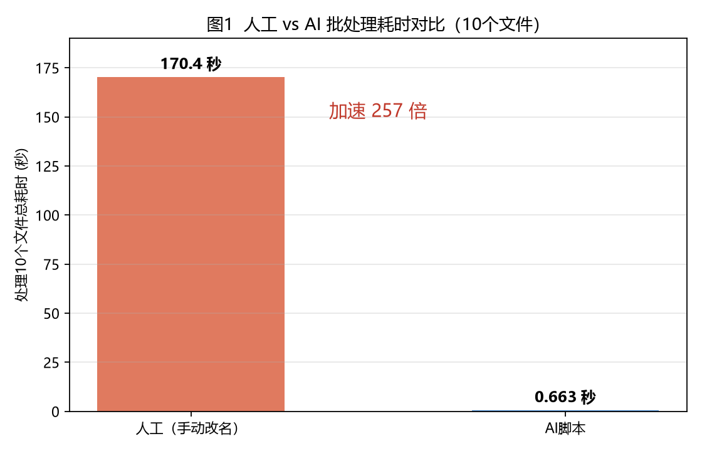

# 课题10：日常数字任务耗时审计与 AI 批处理实证

**任务**：整理 10 个命名混乱的实验素材文件，统一改成规范命名。
**样本**：`samples/` 下 10 个文件（5 张截图 jpg、3 个数据包 zip、1 个表格 csv、1 个文档 md）
**人工命名规范**（本人手工执行）：`课题8_<类型><两位序号>.<扩展名>`
**AI 命名规范**（脚本执行）：`课题08_<类型>_<两位序号>.<扩展名>`

## 1. 对比结果

| 指标 | 人工（手动右键改名） | AI（Python 脚本） |
|---|---|---|
| 处理 10 个文件总耗时 | **170.4 秒**（2 分 50 秒） | **0.663 秒** |
| 单文件平均耗时 | 17.04 秒 | 0.066 秒 |
| 出错/返工次数 | 0（但过程中多次需要确认文件名） | 0 |
| 前期投入 | 0 | 编写+调试脚本约 5 分钟 |

**加速比：170.4 ÷ 0.663 ≈ 257 倍**



## 2. 数据来源与可信度

- 人工耗时取自**完整录屏** `人工修改名字.mp4`（时长 2 分 50 秒，即 170.4 秒），非事后估算；
- 人工结果保存在 `samples_备份/`，AI 结果保存在 `samples/`，两者可逐项核对；
- AI 耗时由脚本内部用 `time.perf_counter()` 计时，写入 `results/AI耗时.csv`。

## 3. 分析

1. **人工时间花在哪**：单个文件平均 17 秒，其中真正"打字改名"不到 3 秒，其余都花在"看原文件名 → 判断是什么类型 → 想序号排到几 → 检查有没有改错"这类重复认知动作上。改到后面容易串号。
2. **AI 的优势是一致性**：规则写死在代码里，10 个和 1000 个成本几乎一样，不会因为疲劳而出错。
3. **但 AI 不一定总更快**：本次脚本从提出需求到调试通过约 5 分钟。如果只改这 10 个文件，人工 2 分 50 秒反而更快。**只有任务重复次数足够多，写脚本才划算**——按本题数据，盈亏平衡点约在处理 12 个文件。
4. **真正的价值不是"快"，是"可复用"**：脚本留存后，以后每次导出数据都能一键规范化，这正是"用工具代替重复劳动"的意义。

## 4. 人机校验规则（防 AI 批量出错）

1. **先预览后执行**：脚本默认 dry-run，只打印"将要改成什么"，人工确认无误后加 `--run` 才真正改名。
2. **先备份**：执行前把 `samples/` 完整复制为 `samples_备份/`，改错可整体还原。
3. **数量守恒**：改名前后的文件数必须一致（本实验均为 10），不一致立即中止。
4. **边界样本人工处理**：`IMG_4837 (1).jpg` 这类带括号的重复下载文件，脚本只能按规则编号，是否为真重复需人工判断。
5. **结果可核对**：人工结果与 AI 结果并存，可逐项比对命名是否一致。

## 5. 复现

```bash
python rename_batch.py          # 预览，不改文件
python rename_batch.py --run    # 确认后执行
```

## 6. 证据清单

| 文件 | 说明 |
|---|---|
| `results/人工计时表.csv` | 人工组 10 个文件的原名→新名映射与总耗时 |
| `results/AI耗时.csv` | 脚本运行耗时记录 |
| `results/耗时对比.png` | 耗时对比柱状图 |
| `samples/`、`samples_备份/` | AI 结果、人工结果（可核对） |
| 录屏 `人工修改名字.mp4` | 人工操作全过程（2分50秒，因体积>100MB 未上传，可现场提供） |
| `工作照_人工改名操作现场.jpg` | 2026-11-15 晚在文件资源管理器中人工重命名文件的操作现场（本人+屏幕同框） |
